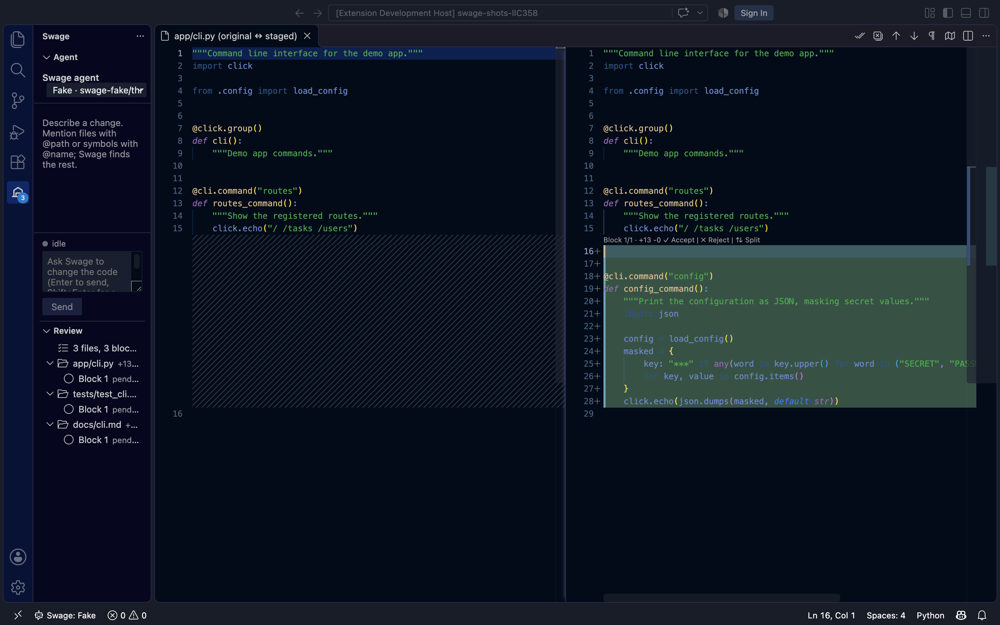
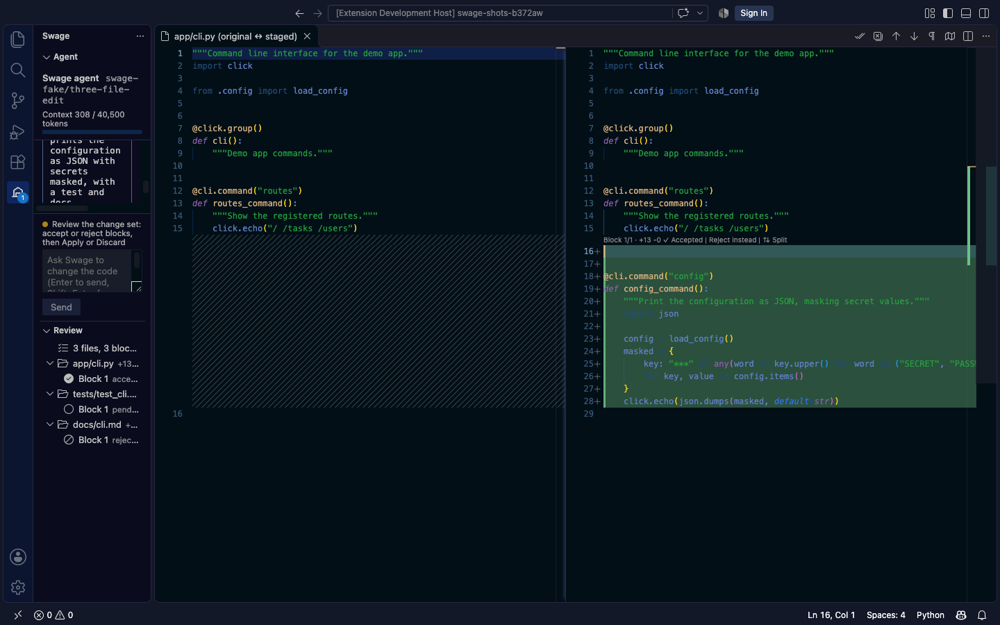

# Swage

**An editor-native coding agent for VS Code whose agent loop runs on [TrueForge](https://github.com/truefoundry/trueforge).** Built from scratch for the TrueFoundry Forge-a-thon (Techfest 2026-27).

Swage makes inline edits and multi-file changes the way a careful engineer reviews them: every change is staged in memory, shown as a native diff with **Accept, Reject and Split on each block**, applied atomically, and undoable. The model never writes to disk.

- **Thin client:** the extension is a TrueForge client. It creates sessions and turns through the TrueForge SDK and renders the streamed events.
- **Tools, not logic:** the editor's capabilities (search, read, propose a write, run tests, run a command) are exposed to the agent as **MCP tools**, so the agent decides what to read and change.
- **Models live in TrueForge:** Swage never calls a model provider directly.





> **No keys in this repository.** API keys and provider URLs are entered only in TrueForge's own settings, stored in its database outside this folder. Swage's profiles name TrueForge models only. The whole git history is scanned for secrets in CI (`npm run scan:secrets`), and tool output is redacted.

## Requirements

- macOS or Linux. Windows is not tested yet.
- [Node.js](https://nodejs.org) **22.14 or newer**, and Git.
- [VS Code](https://code.visualstudio.com) **1.96 or newer**.
- Python 3 with a virtual environment, for the Flask demo tasks (Doctor checks it).
- A model provider key, entered **in TrueForge**. The Gemini free tier works; any model TrueForge can call works.

## Quick start

Copy and paste, one block at a time.

**1. Get the code and build it.**

```bash
git clone https://github.com/tanaygit0530/Swage.git
cd Swage
npm ci
npm run build
```

**2. Start TrueForge** (pinned 0.184.2, local mode, database in `~/trueforge-data`, outside any repository). Leave it running in its own terminal.

```bash
trueforge/start.sh
```

**3. Add models in the TrueForge UI.** Open <http://localhost:8790>, go to **Settings → Models**, add a provider (for example Google Gemini from the catalog) and paste its key there. Note the model names TrueForge lists, such as `google-gemini/gemini-flash-lite-latest`; you need them in step 5.

**4. Run Swage.** Use either option:

- **From source:** open the `Swage` folder in VS Code and press **F5** (configuration **Run Swage Extension**). A new window titled **[Extension Development Host]** opens.
- **As an extension:** build the VSIX and install it.

  ```bash
  npm run package
  ```

  ```bash
  code --install-extension swage-0.1.0.vsix
  ```

  If `code` is not found, run **Shell Command: Install 'code' command in PATH** from VS Code's command palette, or use **Extensions → … → Install from VSIX…** instead.

**5. Point Swage at your models.** In the window where Swage runs, open the folder you want to work on, then add this to its `.vscode/settings.json` (or to your user settings). Use the model names from step 3.

```json
{
  "swage.truefoundry.baseUrl": "http://localhost:8790",
  "swage.autoStart": false,
  "swage.models": [
    {
      "name": "primary",
      "label": "Gemini Flash Lite",
      "trueforgeModel": "google-gemini/gemini-flash-lite-latest"
    },
    {
      "name": "fallback-1",
      "label": "Gemini 3.5 Flash Lite",
      "trueforgeModel": "google-gemini/gemini-3-5-flash-lite"
    }
  ]
}
```

The status bar now shows **Swage: Gemini Flash Lite**.

**6. Check everything.** Press Cmd/Ctrl+Shift+P and run **Swage: Doctor**. It checks:

- Node, and TrueForge with its version;
- the MCP server with and without its token;
- the agents, and a tool call from each model;
- ripgrep, Python, pytest and workspace trust.

Every row should be green; a red row says how to fix it.

The **agent definitions** in `trueforge/agents/*.json` are loaded automatically. Swage registers its MCP server and creates or updates the agents `swage-main-<profile>` and `swage-inline-<profile>` in TrueForge on the first request, and Doctor does the same. You can see them on TrueForge's **Agents** page.

## Using Swage

| What                                | How                                                                                                                                                                                                      |
| ----------------------------------- | -------------------------------------------------------------------------------------------------------------------------------------------------------------------------------------------------------- |
| Inline edit                         | Select code (or put the cursor in a function), press **Cmd/Ctrl+Alt+K**, type the instruction. Review the blocks in the diff, then **Apply**.                                                            |
| Agent mode                          | Click the **Swage** icon in the activity bar, type a request (`@file` and `@symbol` mentions work), press Enter. Review the change set in the **Review** view, **Accept All** or per block, **Apply**.   |
| Stop                                | **Escape** while a run is going, or **Swage: Stop Run**. The workspace is never changed by a stopped run.                                                                                                |
| Undo                                | **Swage: Undo Last Change Set**; it works twice in a row and after a window reload.                                                                                                                      |
| Switch model                        | Use the **model picker** in the agent panel header, or click the status bar item. **Other models… → Add a model from TrueForge…** adds any model TrueForge has (Gemini, Groq, Ollama…) and uses it next. |
| Make the primary fail (demo Task C) | `npm run break-primary -- --workspace ../flask`, then `npm run restore-primary`.                                                                                                                         |

## Model profiles

Profiles are an ordered list: the first is the primary, the rest are fallbacks tried in order. Each names a **TrueForge model** and nothing else secret.

```yaml
# config/models.example.yaml (the same fields go in the swage.models setting)
profiles:
  - name: primary
    kind: hosted # hosted or local
    label: Gemini # shown in banners and the status bar
    trueforgeModel: google-gemini/gemini-3-5-flash-lite
    params: { temperature: 0, max_tokens: 4096 }
    timeouts: { connectMs: 10000, firstTokenMs: 45000, stallMs: 30000, totalMs: 600000 }
```

- **Timeouts:** each attempt has a connect, first-token, stall and total timer. Missing values come from `kind`:
  - hosted: 10 s / 45 s / 30 s / 10 min;
  - local: 10 s / 120 s / 60 s / 15 min, so a slow local model is not mistaken for a dead one.
- **Hard failures** (401, 403, a refused connection, an unknown model) switch to the next profile at once.
- **Transient failures** (429, 5xx) retry with backoff and honour the server's "retry in N s". Timeouts retry once. Then Swage switches, carrying the task, plan and staged edits over. The panel says _"Switched to Groq because Gemini returned 429."_ and no click is needed.
- **Swapping the primary** (for example the organisers' model) is just editing the setting or using **Swage: Switch Model → Change the primary model**. No model name is hard-coded anywhere.

Local models: add Ollama (`http://127.0.0.1:11434/v1`) or a llama.cpp server (`http://127.0.0.1:8080/v1`) as custom providers in TrueForge. `trueforge/start.sh` already allows 127.0.0.1.

## The five required capabilities, and where they live

| Capability                        | What you see                                                                                                                                        | Code                                                                                                                                                                                                                                                                                   |
| --------------------------------- | --------------------------------------------------------------------------------------------------------------------------------------------------- | -------------------------------------------------------------------------------------------------------------------------------------------------------------------------------------------------------------------------------------------------------------------------------------- |
| **1. Inline edit**                | Keybinding, instruction box, native diff in the editor with per-block Accept, Reject and Split; edits locked to the selection                       | [`src/inline/`](src/inline) (context, range lock, code-block fallback, `vscode/controller.ts`), [`trueforge/agents/inline.agent.json`](trueforge/agents/inline.agent.json)                                                                                                             |
| **2. Agent mode**                 | One request; the agent searches, reads, plans, stages several files, runs tests and submits for review                                              | [`src/agent/`](src/agent) (`run.ts`, `controller.ts`), [`src/mcp/tools/`](src/mcp/tools) (nine MCP tools), [`src/ui/webview/`](src/ui/webview) (panel), [`trueforge/agents/main.agent.json`](trueforge/agents/main.agent.json)                                                         |
| **3. Context assembly**           | `@file` / `@symbol` mentions, automatic retrieval, a plan with files and reasons, a token budget bar                                                | [`src/context/`](src/context) (tree-sitter symbols, BM25, import graph, repo map, budgets, mentions), [`src/agent/context.ts`](src/agent/context.ts), [`src/mcp/tools/findRelevantCode.ts`](src/mcp/tools/findRelevantCode.ts), [`declareContext.ts`](src/mcp/tools/declareContext.ts) |
| **4. Diff review and undo**       | Review view of files and blocks, Accept or Reject each block, atomic Apply with a hash check, Undo twice                                            | [`src/changeset/`](src/changeset) (overlay, blocks, apply, checkpoints), [`src/review/`](src/review) (model, session, `vscode/` tree, CodeLens, diff documents, WorkspaceEdit)                                                                                                         |
| **5. Streaming and cancellation** | Tokens and tool calls appear as TrueForge streams them; Escape stops at once; tools are aborted and staged edits discarded; the editor never blocks | [`src/client/events.ts`](src/client/events.ts), [`src/agent/run.ts`](src/agent/run.ts) (`cancel`), [`src/mcp/tasks.ts`](src/mcp/tasks.ts), [`src/mcp/tools/exec.ts`](src/mcp/tools/exec.ts)                                                                                            |

Also: resilience and fallback in [`src/resilience/`](src/resilience), Doctor in [`src/doctor/`](src/doctor), path guard, redaction and the command policy in [`src/safety/`](src/safety), and the TrueForge supervisor in [`src/supervisor/`](src/supervisor).

## Development

```bash
npm run lint && npm test && npm run build   # or ./scripts/verify.sh
npm run test:integration                    # VS Code integration tests
npm run fake-model                          # scripted OpenAI-compatible model server for offline demos
node scripts/rehearse.mjs setup             # clean Flask 3.1.3 clone and baseline
node scripts/rehearse.mjs run               # Tasks A, B and C on real models, evidence in docs/
npm run scan:secrets && npm run check:licences
```

Design and decisions: [`docs/BLUEPRINT.md`](docs/BLUEPRINT.md), verified TrueForge behaviour: [`docs/SPIKES.md`](docs/SPIKES.md), build log: [`docs/PROGRESS.md`](docs/PROGRESS.md), rehearsal evidence: [`docs/EVIDENCE.md`](docs/EVIDENCE.md).

## Limitations

- **Free-tier models are slow and rate-limited.**
  - Inline edits took 5 to 36 s from instruction to diff in rehearsals.
  - Agent-mode runs exhausted Gemini's free tier (250,000 input tokens per minute per model). Swage waits out quotas and caps switches, but finishing Task B reliably needs a paid key or a model with more quota.
- **Models tested:** Gemini (free tier) end to end. Ollama Qwen 7B answered but made no native tool calls through TrueForge (Swage hands the task on). Groq is supported but was not verified.
- The inline instruction box is VS Code's quick input at the top of the window, not a widget inside the editor (that needs a proposed API).
- Retrieval is lexical, symbol and import based, with no embeddings.
- A running task does not yet survive a window reload (applied change sets and their undo do).
- There is no session log export, no "open TrueForge session" command and no performance report command yet.
- Windows is not tested, and CI runs on Ubuntu only.

## Licence

[MIT](LICENSE). Built from scratch; no code was copied or forked. Dependencies are listed in `package.json` and checked by `npm run check:licences`; all shipped ones are MIT, ISC or BSD.
