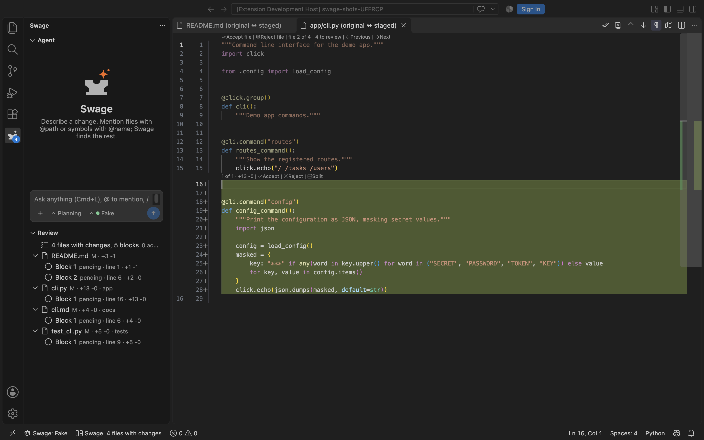
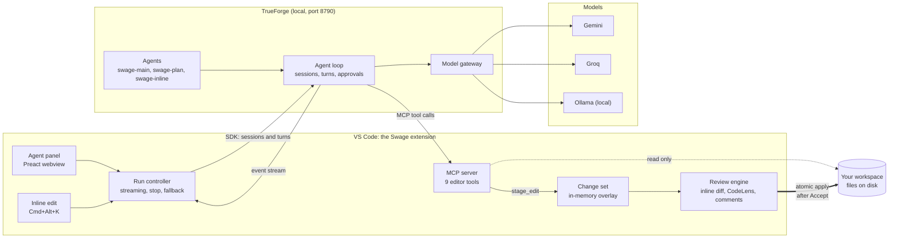
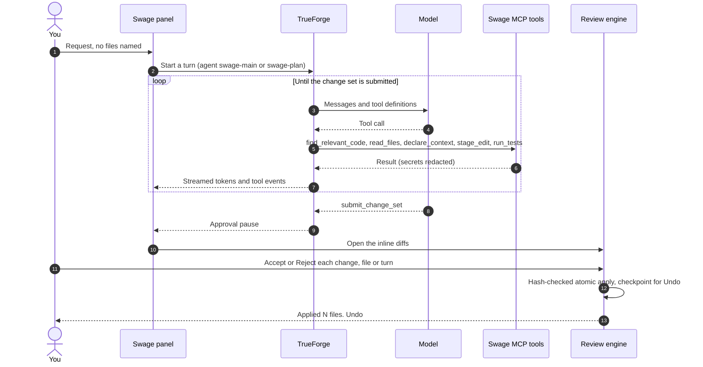
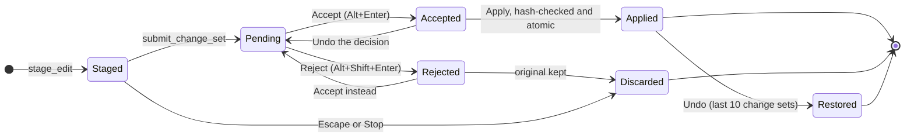
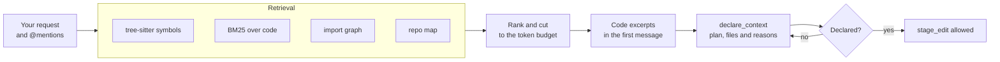
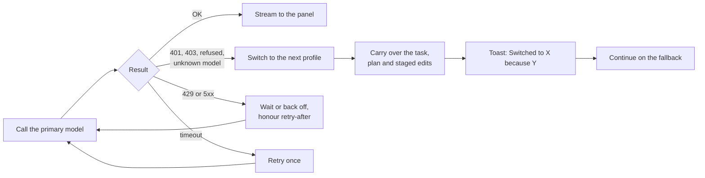
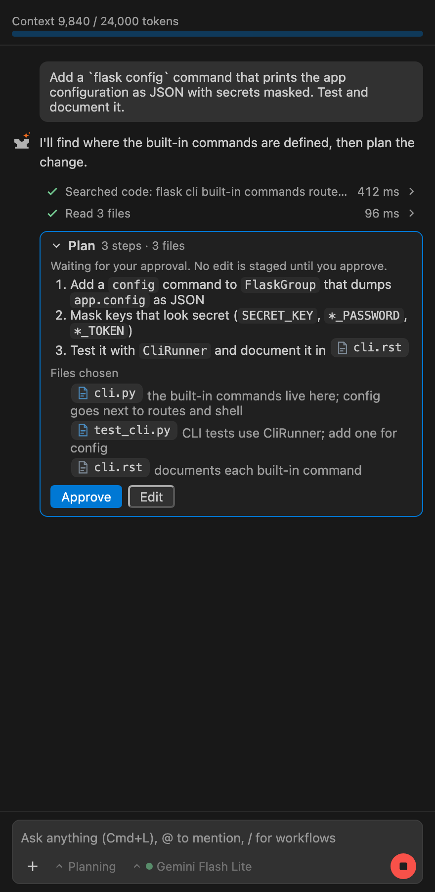
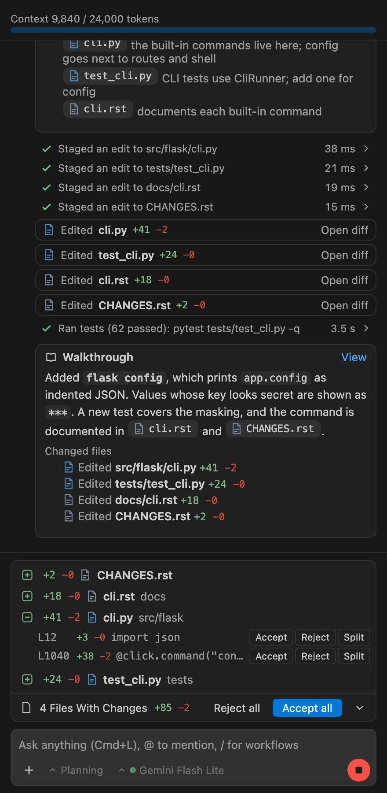
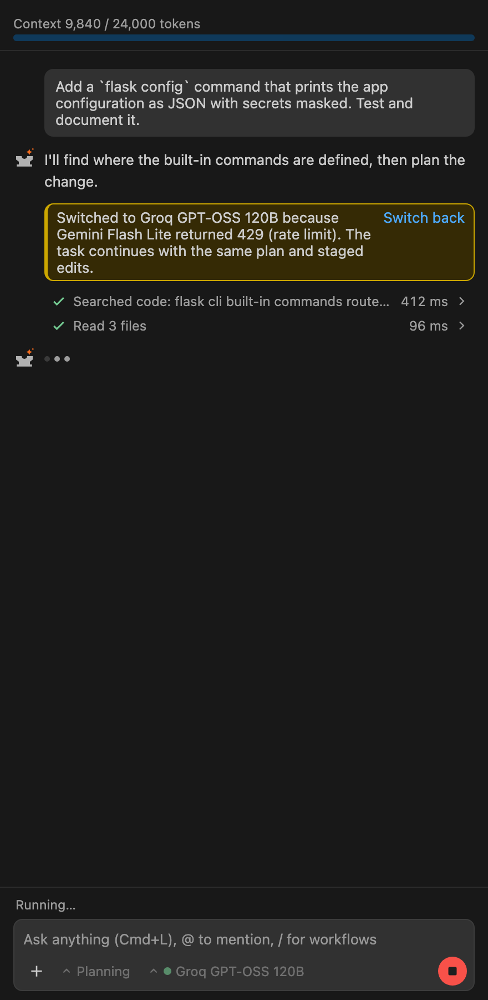

<p align="center">
  <picture>
    <source media="(prefers-color-scheme: dark)" srcset="media/swage-banner-dark.svg">
    
  </picture>
</p>

<p align="center">
  <b>An editor-native coding agent for VS Code whose agent loop runs on <a href="https://github.com/truefoundry/trueforge">TrueForge</a>.</b><br>
  Built from scratch for the TrueFoundry Forge-a-thon (Techfest 2026-27).
</p>

<p align="center">
  
  
  
  
  
</p>

---

## What Swage is

Swage makes inline edits and multi-file changes the way a careful engineer reviews them. Every change is **staged in memory**, shown as a **red and green inline diff** with Accept and Reject on each change, **applied atomically**, and **undoable**. The model never writes to disk.

|                         |                                                                                                                               |
| ----------------------- | ----------------------------------------------------------------------------------------------------------------------------- |
| ✏️ **Inline edit**      | Select code, press **Cmd/Ctrl+Alt+K**, describe the change. The edit stays inside your selection.                             |
| 🤖 **Agent mode**       | One request. The agent finds the files itself, plans, edits several files, runs the tests and hands you the result to review. |
| 🧭 **Context assembly** | Symbol, BM25 and import-graph retrieval under a token budget. The agent must say which files it chose and why before editing. |
| 🔍 **Review and undo**  | Per-change, per-file and per-turn Accept or Reject, comments for the agent, hash-checked atomic apply, and up to 10 undos.    |
| ⚡ **Streaming**        | Tokens and tool calls stream live. Escape stops at once and leaves the workspace untouched.                                   |
| 🛟 **Fallback**         | If a model fails or runs out of quota, Swage switches to the next one and carries the task over, with no click needed.        |



> **No keys in this repository.** API keys are entered only in TrueForge's own settings, stored in its database outside this folder. Swage's profiles name TrueForge models only. The git history is scanned for secrets in CI (`npm run scan:secrets`), and tool output is redacted.

## Architecture

Swage is a **thin client**. TrueForge runs the agent loop and calls the models. The editor's abilities (search, read, stage an edit, run tests, run a command) are **MCP tools** that Swage serves, so the agent decides what to read and change. Only the review engine ever writes to your files, and only after you accept.



### One agent turn



### The life of a change

Nothing reaches the disk until you accept it, and every apply can be undone.



### Context assembly

The agent gets a ranked, budgeted view of the repository, and has to declare its plan before the first edit.



### Fallback without losing work



## Requirements

- macOS or Linux. Windows is not tested yet.
- [Node.js](https://nodejs.org) **22.14 or newer**, and Git.
- [VS Code](https://code.visualstudio.com) **1.96 or newer**.
- Python 3 with a virtual environment, for the Flask demo tasks (Doctor checks it).
- A model provider key, entered **in TrueForge**. The Gemini free tier works; any model TrueForge can call works.

## Quick start

Copy and paste, one block at a time.

**1. Get the code and build it.**

```bash
git clone https://github.com/tanaygit0530/Swage.git
cd Swage
npm ci
npm run build
```

**2. Start TrueForge** (pinned 0.184.2, local mode, database in `~/trueforge-data`, outside any repository). Leave it running in its own terminal.

```bash
trueforge/start.sh
```

**3. Add models in the TrueForge UI.** Open <http://localhost:8790>, go to **Settings → Models**, add a provider (for example Google Gemini from the catalog) and paste its key there. Note the model names TrueForge lists, such as `google-gemini/gemini-flash-lite-latest`.

**4. Run Swage.** Either:

- **From source:** open the `Swage` folder in VS Code and press **F5** (configuration **Run Swage Extension**). A window titled **[Extension Development Host]** opens.
- **As an extension:** build the VSIX and install it.

  ```bash
  npm run package
  ```

  ```bash
  code --install-extension swage-0.1.0.vsix
  ```

**5. Point Swage at your models.** In the folder you want to work on, add this to `.vscode/settings.json` (or your user settings), with the model names from step 3:

```json
{
  "swage.truefoundry.baseUrl": "http://localhost:8790",
  "swage.autoStart": false,
  "swage.models": [
    {
      "name": "primary",
      "label": "Gemini Flash Lite",
      "trueforgeModel": "google-gemini/gemini-flash-lite-latest"
    },
    {
      "name": "fallback-1",
      "label": "Gemini 3.5 Flash Lite",
      "trueforgeModel": "google-gemini/gemini-3-5-flash-lite"
    }
  ]
}
```

**6. Check everything.** Press Cmd/Ctrl+Shift+P and run **Swage: Doctor**. It checks Node, TrueForge and its version, the MCP server with and without its token, the agents and a tool call from each model, and ripgrep, Python, pytest and workspace trust. Every row should be green; a red row says how to fix it.

The **agent definitions** in [`trueforge/agents/`](trueforge/agents) are loaded automatically: Swage registers its MCP server and creates or updates the agents `swage-main-<profile>`, `swage-plan-<profile>` and `swage-inline-<profile>` in TrueForge on the first request. You can see them on TrueForge's **Agents** page.

## Using Swage

| What                  | How                                                                                                                                                                                      |
| --------------------- | ---------------------------------------------------------------------------------------------------------------------------------------------------------------------------------------- |
| **Inline edit**       | Select code, press **Cmd/Ctrl+Alt+K** (on a Mac, ⌥ is Alt), type the instruction. Review the changes in the inline diff, then **Apply**.                                                 |
| **Agent mode**        | Click the **Swage** icon or press **Cmd/Ctrl+L**. Type a request (`@` mentions files and symbols, **+** attaches the selection). Review in the **files-changed bar** above the composer. |
| **Planning or Fast**  | The mode dropdown under the composer. **Planning** shows a Plan card and stages nothing until you click **Approve**; **Fast** runs straight through.                                     |
| **Review a change**   | In the diff: **Alt+Enter** accepts, **Alt+Shift+Enter** rejects, **Alt+↓ / Alt+↑** move between changes. **Accept file** and **Reject file** settle a file and open the next one.        |
| **Comment for agent** | Select lines in a Swage diff and press **Cmd/Ctrl+Alt+M**. Comments go to the agent with your next request.                                                                              |
| **Stop**              | **Escape** while a run is going, or **Swage: Stop Run**. A stopped run never changes the workspace.                                                                                      |
| **Undo**              | **Undo** in the toast, or **Swage: Undo Last Change Set**. Up to 10 change sets, also after a window reload.                                                                             |
| **Switch model**      | The **model dropdown** under the composer, or the status bar item. **Other models… → Add a model from TrueForge…** adds any model TrueForge has.                                         |
| **Demo the fallback** | `npm run break-primary -- --workspace ../flask`, then `npm run restore-primary`.                                                                                                         |

<table>
  <tr>
    <td></td>
    <td></td>
    <td></td>
  </tr>
  <tr>
    <td align="center">Plan with files and reasons</td>
    <td align="center">Files-changed bar</td>
    <td align="center">Automatic fallback</td>
  </tr>
</table>

Every panel state, in dark and light themes, is in [`docs/images`](docs/images) (`npm run screenshots:panel` regenerates them).

## Model profiles

Profiles are an ordered list: the first is the primary, the rest are fallbacks tried in order. Each names a **TrueForge model** and nothing secret.

```yaml
# config/models.example.yaml (the same fields go in the swage.models setting)
profiles:
  - name: primary
    kind: hosted # hosted or local
    label: Gemini # shown in banners and the status bar
    trueforgeModel: google-gemini/gemini-3-5-flash-lite
    params: { temperature: 0, max_tokens: 4096 }
    timeouts: { connectMs: 10000, firstTokenMs: 45000, stallMs: 30000, totalMs: 600000 }
```

- **Timeouts** come from `kind` when missing: hosted 10 s / 45 s / 30 s / 10 min; local 10 s / 120 s / 60 s / 15 min.
- **Hard failures** (401, 403, a refused connection, an unknown model) switch at once. **Transient failures** (429, 5xx) wait and retry first.
- **Local models:** add Ollama (`http://127.0.0.1:11434/v1`) or a llama.cpp server as a custom provider in TrueForge. A small model can be marked `inlineOnly` so agent mode skips it.
- No model name is hard-coded anywhere.

## Where the code lives

| Capability                     | Code                                                                                                                                                                                       |
| ------------------------------ | ------------------------------------------------------------------------------------------------------------------------------------------------------------------------------------------ |
| **Inline edit**                | [`src/inline/`](src/inline), [`trueforge/agents/inline.agent.json`](trueforge/agents/inline.agent.json)                                                                                    |
| **Agent mode**                 | [`src/agent/`](src/agent), [`src/mcp/tools/`](src/mcp/tools) (nine MCP tools), [`src/ui/webview/`](src/ui/webview), [`trueforge/agents/main.agent.json`](trueforge/agents/main.agent.json) |
| **Context assembly**           | [`src/context/`](src/context) (symbols, BM25, import graph, repo map, budgets, mentions), [`src/agent/context.ts`](src/agent/context.ts)                                                   |
| **Diff review and undo**       | [`src/changeset/`](src/changeset) (overlay, blocks, apply, test guard), [`src/review/`](src/review) (session, queue, marks, comments, checkpoints, `vscode/`)                              |
| **Streaming and cancellation** | [`src/client/events.ts`](src/client/events.ts), [`src/agent/run.ts`](src/agent/run.ts), [`src/mcp/tasks.ts`](src/mcp/tasks.ts)                                                             |
| **Resilience**                 | [`src/resilience/`](src/resilience) (classify, fallback, carry-over, probes)                                                                                                               |
| **Safety and setup**           | [`src/safety/`](src/safety) (path guard, redaction, command policy), [`src/doctor/`](src/doctor), [`src/supervisor/`](src/supervisor)                                                      |

| MCP tool             | What it does                                           | Needs approval |
| -------------------- | ------------------------------------------------------ | :------------: |
| `find_relevant_code` | Ranked code search with excerpts, within a budget      |                |
| `repo_map`           | A compact map of files and symbols                     |                |
| `read_files`         | Reads files (secrets redacted)                         |                |
| `get_symbol`         | One symbol's definition                                |                |
| `declare_context`    | The plan: files chosen and why (required before edits) |                |
| `stage_edit`         | Stages an edit in memory, never on disk                |                |
| `run_tests`          | Runs the tests against the staged files                |                |
| `run_command`        | Runs an allowed command                                |       ✅       |
| `submit_change_set`  | Hands the change set to you for review                 |       ✅       |

## Development

```bash
./scripts/verify.sh                 # lint, unit tests and build
npm run test:integration            # VS Code integration tests
npm run fake-model                  # scripted model server for offline demos
npm run scan:secrets && npm run check:licences
```

Design and decisions: [`docs/BLUEPRINT.md`](docs/BLUEPRINT.md) · verified TrueForge behaviour: [`docs/SPIKES.md`](docs/SPIKES.md) · build log: [`docs/PROGRESS.md`](docs/PROGRESS.md) · rehearsal evidence: [`docs/EVIDENCE.md`](docs/EVIDENCE.md).

## Limitations

- **Free-tier models are slow and rate-limited.** Inline edits took 5 to 36 s in rehearsals. Agent mode can finish the Flask `config` task on free Gemini, but not every run: quotas run out and the model sometimes makes mistakes.
- **Models tested:** Gemini end to end. Ollama Qwen 2.5 Coder 3B is used for inline edits only. Groq is supported but was not verified.
- The inline instruction box is VS Code's quick input at the top of the window, not a widget inside the editor (that needs a proposed API).
- Retrieval is lexical, symbol and import based, with no embeddings.
- A running task does not survive a window reload (applied change sets and their undo do).
- Windows is not tested: CI requires Linux and macOS, and runs Windows only as an experiment.

## Licence

[MIT](LICENSE). Built from scratch; no code was copied or forked. All shipped dependencies are MIT, ISC or BSD (`npm run check:licences`).
